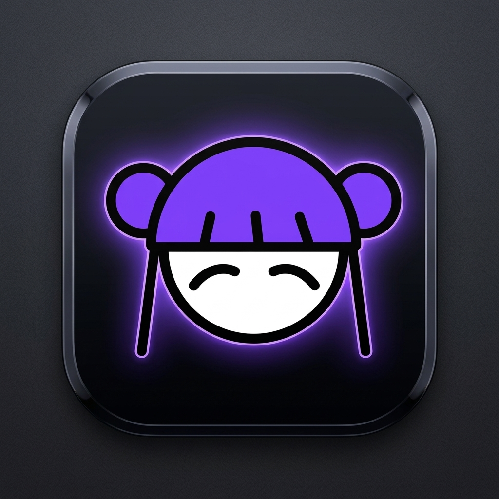
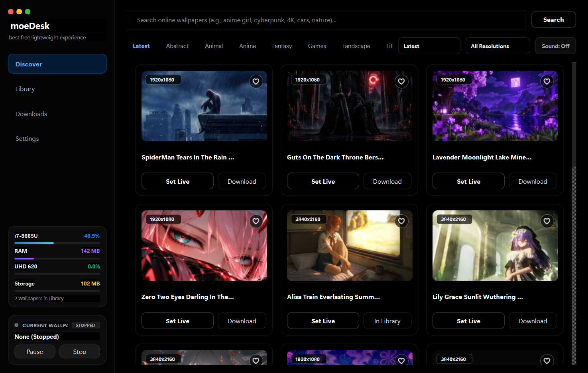
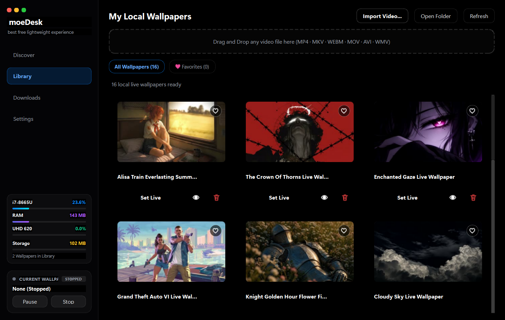
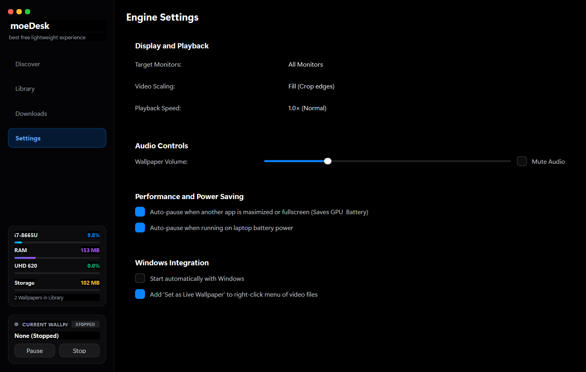

# moeDesk

### Modern GPU-Accelerated Live Wallpaper Engine for Windows 10 & 11

[-41CD52?style=for-the-badge&logo=qt&logoColor=white)](#)

[-0A84FF?style=for-the-badge&logo=windows)](https://github.com/sanugasandeshnew/moeDesk/releases/latest)

 

*Online Discover explorer with live MoeWalls feed, resolution tags, sort order, and sound filter.*

---

## Highlights

- **Full AMOLED Pitch Black (`#000000`) & macOS Liquid Glass UI**: Clean dark interface with zero visual bloat.
- **Online Discover Hub (MoeWalls Integration)**:
  - Browse trending categories: Anime, Abstract, Cyberpunk, Gaming, Landscape, Sci-Fi, and more.
  - **Popularity Sort Dropdown**: Filter by *Latest*, *Most Upvoted*, *Most Discussed*, and *Oldest*.
  - **Resolution Filter**: Filter by *All Resolutions*, *1280x720*, *1920x1080*, *2560x1080*, *2560x1440*, *3440x1440*, *3840x2160 (4K)*, and *5120x1440*.
  - **Audio Toggle Filter**: 1-click filter for wallpapers with audio tracks.
  - **Dynamic Card Badges**: Clear resolution and sound indicator tags directly on each wallpaper thumbnail.
  - **1-Click "Set Live"**: Seamlessly downloads and applies the wallpaper directly to your desktop background.
- **Native Windows Live Engine**:
  - Hooks seamlessly behind Windows desktop icons using `WorkerW` / `Progman` (`SHELLDLL_DefView`).
  - Hardware GPU video acceleration with smooth 60fps playback and infinite looping.
  - Multi-monitor support: Apply across all displays or primary display.
  - Video scaling modes: *Fill (Crop edges)*, *Fit (Letterbox)*, *Stretch*.
  - Playback speed adjustment (0.5x – 2.0x) and volume slider with mute toggle.
- **Hardware-Aware System Monitor**:
  - Auto-detects installed CPU (Intel Core / Ultra, AMD Ryzen) and GPU (Intel UHD/Iris, NVIDIA RTX, AMD Radeon).
  - Displays real-time CPU, RAM, and GPU usage consumed by moeDesk.
- **Smart Resource Management**:
  - Automatically pauses video playback when fullscreen applications or games are active.
  - Automatically pauses on laptop battery power to maximize battery life.
- **System Tray Integration**:
  - Runs quietly in the Windows system tray when the main window is closed.
  - Right-click tray menu for quick actions (Pause/Resume, Mute, Stop, Quit).

---

## Screenshots

### Local Wallpaper Library & Drag-and-Drop

 

### Engine Settings & Performance Controls

---

## Quick Start

### Option 1: Standalone Portable Executable (Recommended)
No installation required:
1. Double-click `moeDesk.exe` (or `exe.bat`).
2. moeDesk will launch immediately.

### Option 2: Run from Source
1. Ensure **Python 3.10+** is installed on your Windows system.
2. Double-click [`RUN.bat`](RUN.bat) to install dependencies into a local virtual environment and launch the app.
3. To stop any active wallpaper, double-click [`STOP.bat`](STOP.bat).

---

## Building the Executable

To compile moeDesk into a single standalone Windows executable:
1. Double-click [`BUILD_EXE.bat`](BUILD_EXE.bat).
2. The standalone portable file will be generated at `moeDesk.exe` and `dist\moeDesk.exe`.

---

## Technologies Used

- **Language**: Python 3.11+
- **GUI Framework**: PySide6 (Qt 6.7+)
- **Video Engine**: QtMultimedia (DirectShow / Media Foundation)
- **Scraper / Network**: cloudscraper, BeautifulSoup4
- **System APIs**: Windows Win32 API (`ctypes`, `user32.dll`, `dwmapi.dll`), `psutil`

---

## License

This project is licensed under the MIT License.
